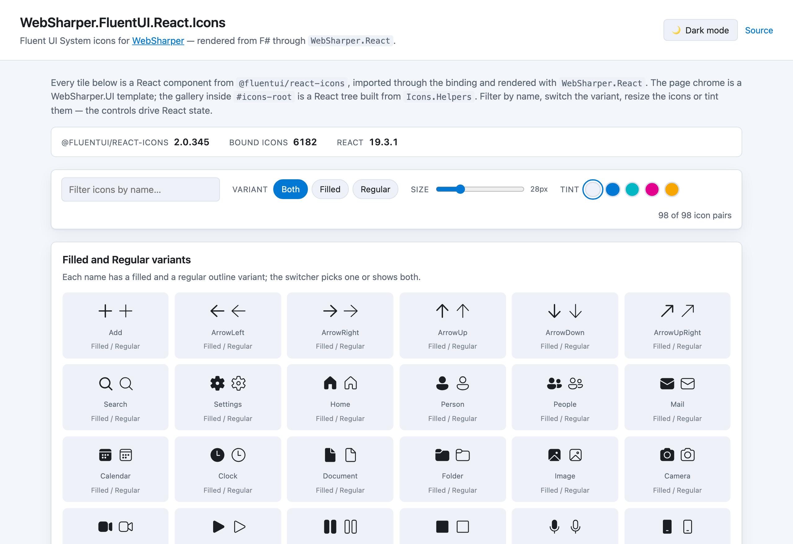

# WebSharper.FluentUI.React.Icons

[](https://www.nuget.org/packages/WebSharper.FluentUI.React.Icons)

**WebSharper.FluentUI.React.Icons** binds [Fluent UI System Icons](https://github.com/microsoft/fluentui-system-icons)
for [WebSharper](https://websharper.com). Every icon exported by `@fluentui/react-icons` becomes a typed F# value
that composes with the `WebSharper.React` combinators, plus an element helper that renders it.

The binding targets **`@fluentui/react-icons` `>= 2.0.345 < 3.0.0`**, imported from its npm package and bundled by
WebSharper together with your application. It covers **6182 icons**: the `Filled` / `Regular` variants, the
multi-colour `Color` icons and the language-specific text icons (`TextBoldFilled_en`, `TextItalicRegular_ko`, …).

This repository contains:

| Project | Purpose |
| --- | --- |
| `WebSharper.React.FluentUI.Icons` | The binding: the `Icons` module (one `[<Inline>]` value per npm export) and `Icons.Helpers` (one element helper per icon). |
| `WebSharper.React.FluentUI.Icons.Sample` | A static SPA that renders an icon gallery from F#: a WebSharper.UI template as the page chrome, hosting a React gallery built with the binding. |

## Live demos

**Try it live:** [Open the sample in your browser](https://dotnet-websharper.github.io/fluentui-react-icons/)



The sample doubles as the binding's [test case](#running-the-test-case): a filterable gallery of 98 filled/regular
icon pairs and 20 colour icons, with controls for the variant, the size (`fontSize`) and the tint (`primaryFill`).
The light/dark switcher in the header drives the CSS palette, which the icons follow through `currentColor`.

- **Sample (this repository):** <https://dotnet-websharper.github.io/fluentui-react-icons/>
- **Source repository:** <https://github.com/dotnet-websharper/fluentui-react-icons>
- **WebSharper bindings:** <https://websharper.com/bindings>

## Installation

```bash
dotnet add package WebSharper.FluentUI.React.Icons
```

or in Paket:

```
nuget WebSharper.FluentUI.React.Icons
```

The binding is npm-based: it imports `@fluentui/react-icons` at runtime (and `react` / `react-dom` through
`WebSharper.React`), so your application must bundle those npm packages — the sample does this with esbuild (see
`WebSharper.React.FluentUI.Icons.Sample/package.json`).

## Usage

Import the icon from the `Icons` module, or use the matching helper in `Icons.Helpers` — it takes the props and
renders the element for you:

```fsharp
namespace MyApp

open WebSharper
open WebSharper.React
open WebSharper.FluentUI.React

[<JavaScript>]
module Demo =

    /// A React prop. Props are string-keyed.
    let private prop (k: string) (v: obj) = (k, v)

    let view =
        Html.div [ prop "className" "toolbar" ] [
            // The helpers are the icons with their first letter lower-cased.
            Icons.Helpers.addFilled [ prop "fontSize" 20; prop "title" "Add" ]
            Icons.Helpers.searchRegular [ prop "fontSize" 20; prop "primaryFill" "#0078d4" ]

            // The components themselves are exposed too, for composition in a React tree.
            ReactHelpers.Elt Icons.SettingsFilled [ prop "fontSize" 24 ] []

            // Colour icons ship their own palette; give each instance an idPrefix so the
            // gradient/clip-path ids of the SVG stay unique on the page.
            ReactHelpers.Elt Icons.CalendarColor [ prop "idPrefix" "calendar-1" ] []
        ]
```

Every icon name exported by the npm package is available under `Icons`, and the helper for `FooBarFilled` is
`Icons.Helpers.fooBarFilled` (only the first letter changes). Language-specific icons keep their suffix:
`Icons.Helpers.textBoldFilled_en`.

## Notes on the API

- **One value per export.** `Icons` mirrors the npm package's surface, in the package's declaration order: 6182
  values. Names follow the upstream conventions — `<Name>Filled` / `<Name>Regular`, `<Name>Color`, and
  `<Name>_<language>` for the localized text icons.
- **Props are string-keyed.** Icons are React components, so a `seq<string * obj>` is all they take: `fontSize`,
  `primaryFill`, `className`, `title` (which becomes `aria-label`), `idPrefix`, and any SVG attribute.
- **Sizing.** The unsized icons render at `1em`, so `fontSize` scales them — set it per icon, or let it inherit
  from CSS. The upstream *sized* variants (`Add20Filled`, …) are a different export family and are not part of
  this binding.
- **Colouring.** `primaryFill` defaults to `currentColor`, so monotone icons follow the surrounding CSS `color`
  (that is how the sample's light/dark switcher works) and any CSS colour can be passed explicitly.
- **`idPrefix`.** `Color` icons embed gradients, clip paths and filters with global SVG ids; pass a unique
  `idPrefix` per rendered instance to keep them from colliding when the same icon appears twice.
- **Generics.** The values are `[<Inline>]` and generic (`Icons.AddFilled<'a>`), so they are only imported and
  emitted when they are actually used.
- **Generated surface.** `Library.fs` is generated from the npm package by [`tools/gen-icons.py`](tools/gen-icons.py):
  run `npm install`, then `python3 tools/gen-icons.py` after bumping the package. `--check` verifies the committed
  file is in sync. The npm version is pinned in the binding's `.fsproj` (`<NpmDependencies>`), in the repository
  `package.json` and in the sample.
- **React version.** The sample uses **React 19** (`react` / `react-dom` `^19.3.1`). `@fluentui/react-icons` 2.x
  supports React `>=16.8 <20`.

## Running the test case

Build the sample in Release and serve its static output:

```bash
dotnet build WebSharper.React.FluentUI.Icons.Sample/WebSharper.React.FluentUI.Icons.Sample.fsproj -c Release
dotnet tool install -g dotnet-serve   # once
dotnet serve -d dist -p 8080
```

Open <http://localhost:8080/>. The gallery mounts on load; type in the filter box, switch the variant, resize or
tint the icons, and use the header toggle to switch between the light and dark themes (the choice is persisted in
`localStorage`).

## Building from source

### Prerequisites

- [.NET SDK 11](https://dotnet.microsoft.com/download) (preview) — the WebSharper compiler needs the .NET 11
  runtime.
- [Node.js](https://nodejs.org/) for the sample's npm bundle.

### Build

```bash
dotnet tool restore
dotnet paket restore
dotnet build WebSharper.React.FluentUI.Icons.sln -c Release
```

The binding targets `netstandard2.0`; the sample targets `net10.0`.

### Pack

```bash
WSPackageFolder=/tmp/pkg dotnet fsi ./build.fsx -t WS-Package
```

## Deployment

Pushing to `main` triggers `.github/workflows/ghpages.yml`, which builds the sample in Release and publishes
`dist/` to the `gh-pages` branch.

## Repository layout

```
WebSharper.React.FluentUI.Icons/          # binding (netstandard2.0)
  Library.fs                              # generated: Icons + Icons.Helpers
tools/gen-icons.py                        # regenerates Library.fs from the npm package
WebSharper.React.FluentUI.Icons.Sample/   # sample SPA (net10.0)
  Client.fs                               # WebSharper.UI chrome + the React icon gallery
  index.html
  site.css
  esbuild.config.mjs
docs/sample.png                           # screenshot of the sample
nuget/                                    # Paket pack template
.github/workflows/ghpages.yml             # build + deploy the sample to GitHub Pages
```

## License

Apache 2.0 — see [LICENSE.md](LICENSE.md).